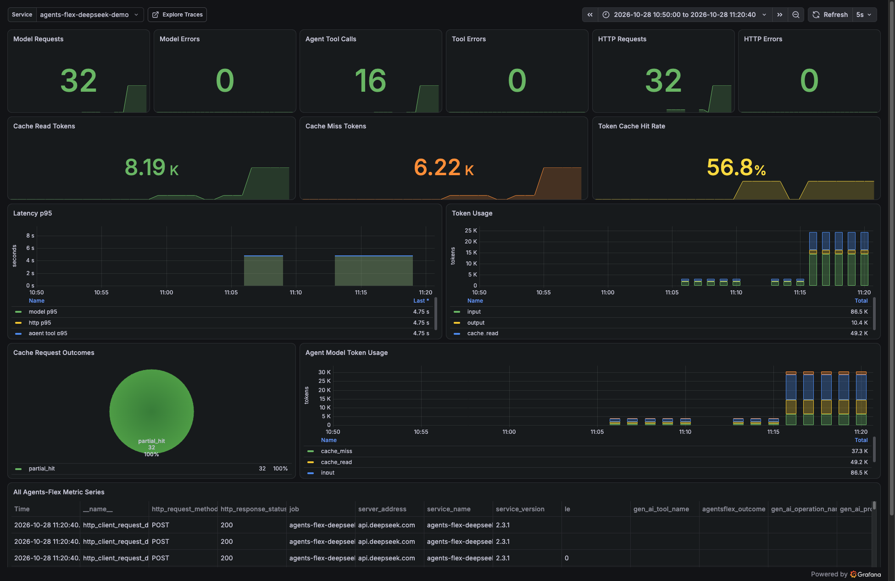
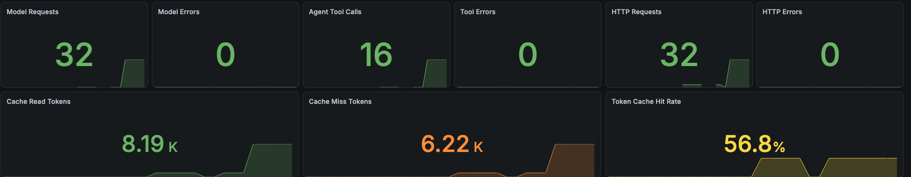
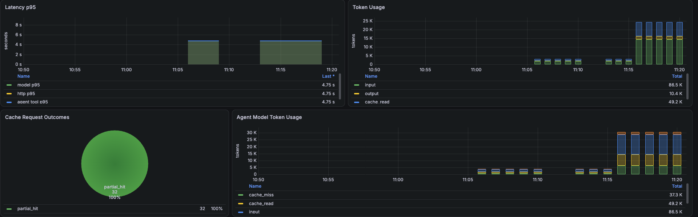

<div v-pre>

# 使用 Grafana 查看 Agents-Flex 指标

这篇教程面向第一次接触 Grafana 和 OpenTelemetry 的开发者。完成后，你会在本机启动一套可观测环境，运行一个真实的 DeepSeek Agent，并在 Grafana 中看到模型请求、工具调用、延迟、Token 用量和 Prompt Cache 等数据。



## 你会搭建什么

本教程使用仓库中已经准备好的 `observability/otel-lgtm` Docker 环境和 Agents-Flex Dashboard：

```text
真实 DeepSeek Agent
        │
        │ OTLP gRPC，端口 4317
        ▼
OpenTelemetry Collector
        ├── Metrics ──> Prometheus ──> Grafana Dashboard
        └── Traces  ──> Tempo      ──> Grafana Explore
```

先记住每个组件的职责：

| 组件 | 可以先理解为 | 在本教程中的作用 |
| --- | --- | --- |
| Agents-Flex | 产生数据的应用 | 自动记录模型、Agent、工具和 HTTP 遥测数据 |
| OpenTelemetry Collector | 数据中转站 | 接收应用通过 OTLP 发来的 Metrics 和 Traces |
| Prometheus | 指标数据库 | 保存请求数、错误数、耗时和 Token 等聚合数据 |
| Tempo | 链路数据库 | 保存一次 Agent 执行包含了哪些步骤、每步用了多久 |
| Grafana | 查询和展示界面 | 把指标做成面板，也可以查询 Tempo Trace |

Grafana 本身不是埋点 SDK，也不直接调用 DeepSeek。没有应用产生遥测数据时，Dashboard 显示 `No data` 是正常的。

## 准备工作

开始前请确认本机已经安装：

- Docker Desktop 或兼容 Docker Engine，并且 Docker 服务正在运行；
- Docker Compose v2，可执行 `docker compose version`；
- JDK 8 或更高版本；
- Maven 3.8 或更高版本；
- 一个可用的 DeepSeek API Key。

以下命令都在 Agents-Flex 仓库根目录执行。不要把 API Key 写进源码，也不要提交包含密钥的 `.env` 文件。

## 第一步：用 Docker 启动 Grafana

仓库中的 Compose 文件会启动一个 LGTM 开发容器，并自动加载 Agents-Flex Dashboard：

```bash
docker compose -f observability/otel-lgtm/docker-compose.yml up -d
```

查看容器状态：

```bash
docker compose -f observability/otel-lgtm/docker-compose.yml ps
```

看到 `agents-flex-otel-lgtm` 为 `Up` 或 `running` 后，打开：

```text
http://127.0.0.1:3000
```

默认账号和密码都是 `admin`。本地 Compose 同时开启了匿名只读访问，因此通常也可以直接查看 Dashboard。首次登录时如果 Grafana 要求修改密码，本地演示可以跳过；生产环境绝不能继续使用默认密码或匿名访问。

本地端口如下：

| 地址 | 用途 |
| --- | --- |
| `http://127.0.0.1:3000` | Grafana 页面 |
| `http://127.0.0.1:4317` | OTLP gRPC，Demo 默认使用 |
| `http://127.0.0.1:4318` | OTLP HTTP，供其他客户端使用 |

## 第二步：配置 DeepSeek 密钥

如果仓库根目录已有只在本地使用的 `.env`，可以写入：

```bash
DEEPSEEK_API_KEY=你的真实密钥
```

然后把变量加载到当前终端：

```bash
set -a
source .env
set +a
```

也可以只对当前终端设置：

```bash
export DEEPSEEK_API_KEY=你的真实密钥
```

验证变量是否存在时，不要打印密钥内容：

```bash
test -n "$DEEPSEEK_API_KEY" && echo "DEEPSEEK_API_KEY is set"
```

## 第三步：编译并运行真实 Agent

先编译 Demo 及其依赖模块：

```bash
mvn -pl demos/agent-demo -am install -DskipTests
```

设置模型和演示参数：

```bash
export DEEPSEEK_MODEL=deepseek-chat
export DEEPSEEK_DEMO_CACHE_PROBE_PAIRS=8
export DEEPSEEK_DEMO_PAUSE_MILLIS=1500
```

运行真实 DeepSeek Agent：

```bash
mvn -f demos/agent-demo/pom.xml exec:java \
  -Dexec.args=deepseek-otel \
  -Dexec.cleanupDaemonThreads=false
```

这个 Demo 会执行重复但真实的 Agent 对话。每一次 Agent Turn 都会：

1. 请求 DeepSeek 决定调用哪个工具；
2. 调用本地 `get_current_time` 工具；
3. 再请求 DeepSeek 生成最终答案；
4. 把 Agent、模型、工具和 HTTP 数据通过 OTLP 发到 Collector；
5. 使用稳定提示词重复多组请求，尽量产生可观察的 Prompt Cache 数据。

终端出现 `Prompt Cache total` 且没有异常时，说明调用已经完成。DeepSeek Prompt Cache 是尽力命中机制，即使提示词相同，也不能保证每次都命中。

Demo 已内置以下可观测配置，因此不需要额外传 JVM 参数：

```properties
agentsflex.otel.enabled=true
agentsflex.otel.exporter.type=otlp
agentsflex.otel.service.name=agents-flex-deepseek-demo
agentsflex.otel.metric.export.interval=2
otel.exporter.otlp.endpoint=http://127.0.0.1:4317
```

接入自己的应用时，应在第一次模型或 HTTP 调用之前设置相同类型的参数。`service.name` 建议使用稳定、易区分环境的名称，例如 `customer-service-agent`，不要把用户 ID、会话 ID 等高基数字段放进服务名或 Metric 标签。

## 第四步：打开 Agents-Flex Dashboard

打开 Grafana 后，首页会加载：

```text
Agents-Flex / Agents-Flex DeepSeek Agent Observability
```

如果没有自动打开，可以从左侧菜单进入 **Dashboards**，搜索 `Agents-Flex`。在页面顶部确认：

- `service` 选择了 `agents-flex-deepseek-demo`；
- 时间范围覆盖了刚才运行 Demo 的时刻，例如 `Last 15 minutes`；
- 自动刷新可以设为 `5s`。



### 核心数字怎么看

| 面板 | 含义 | 判断思路 |
| --- | --- | --- |
| Model Requests | 模型请求总数 | 一次 Agent Turn 可能包含多次模型请求 |
| Model Errors | 模型请求失败数 | 正常演示应为 0 |
| Agent Tool Calls | Agent 工具调用总数 | 本 Demo 每个 Turn 至少调用一次工具 |
| Tool Errors | 工具调用失败数 | 非 0 时进入 Tempo 查看失败 Span |
| HTTP Requests / Errors | 底层 HTTP 请求及错误 | 可帮助区分模型逻辑错误与网络错误 |
| Prompt Cache Read Tokens | DeepSeek 从缓存读取的输入 Token | 越高表示越多稳定前缀被复用 |
| Prompt Cache Miss Tokens | 未从缓存读取的输入 Token | 由输入 Token 减去缓存读取 Token 得到 |
| Token Cache Hit Rate | Token 维度的缓存命中率 | `cache read / input tokens × 100%` |

### 为什么请求数比 Agent Turn 多

一个有工具调用的 Agent 通常至少请求模型两次：第一次让模型选择工具，第二次把工具结果交给模型生成答案。因此 16 个 Turn 出现约 32 次模型请求是合理的，并不代表重复计数。

## 第五步：理解 Token 与 Prompt Cache



Dashboard 中最容易混淆的是输入 Token 与缓存 Token：

- `input tokens` 是模型处理的全部输入 Token，包含从 Prompt Cache 读取的部分；
- `cache read input tokens` 是输入 Token 中由供应商缓存复用的部分；
- `cache miss input tokens` 是 `input tokens - cache read input tokens`；
- Token 缓存命中率是 `cache read input tokens / input tokens`。

因此，不能把 `input tokens` 和 `cache read tokens` 直接相加，否则会重复计算。

当前指标命名遵循两条规则：

| 前缀 | 含义 | 示例 |
| --- | --- | --- |
| `gen_ai.*` | OpenTelemetry GenAI 语义约定中的标准指标 | `gen_ai.client.inference.usage.input_tokens` |
| `agentsflex.*` | Agents-Flex 框架扩展指标 | `agentsflex.gen_ai.request.count` |

常用标准指标：

```text
gen_ai.client.inference.duration
gen_ai.client.inference.usage.input_tokens
gen_ai.client.inference.usage.output_tokens
gen_ai.client.inference.usage.cache_read.input_tokens
```

Prometheus 会把点号转换为下划线，并根据类型增加 `_total`、`_seconds_bucket` 等后缀。例如 `gen_ai.client.inference.usage.input_tokens` 在 PromQL 中通常显示为：

```text
gen_ai_client_inference_usage_input_tokens_total
```

这只是 Prometheus 的名称转换，不是 Agents-Flex 又定义了一套指标。

## 第六步：在 Explore 中查询指标

进入 Grafana 左侧的 **Explore**，选择 `Prometheus` 数据源。以下查询可以直接粘贴使用。

模型请求总数：

```promql
sum(agentsflex_gen_ai_request_count_total{service_name="agents-flex-deepseek-demo"})
```

输入和输出 Token：

```promql
sum(gen_ai_client_inference_usage_input_tokens_total{service_name="agents-flex-deepseek-demo"})
```

```promql
sum(gen_ai_client_inference_usage_output_tokens_total{service_name="agents-flex-deepseek-demo"})
```

Prompt Cache Read Token：

```promql
sum(gen_ai_client_inference_usage_cache_read_input_tokens_total{service_name="agents-flex-deepseek-demo"})
```

Prompt Cache Miss Token：

```promql
clamp_min(
  sum(gen_ai_client_inference_usage_input_tokens_total{service_name="agents-flex-deepseek-demo"})
  -
  sum(gen_ai_client_inference_usage_cache_read_input_tokens_total{service_name="agents-flex-deepseek-demo"}),
  0
)
```

Token 缓存命中率：

```promql
100 *
sum(gen_ai_client_inference_usage_cache_read_input_tokens_total{service_name="agents-flex-deepseek-demo"})
/
clamp_min(
  sum(gen_ai_client_inference_usage_input_tokens_total{service_name="agents-flex-deepseek-demo"}),
  1
)
```

模型 P95 延迟：

```promql
histogram_quantile(
  0.95,
  sum by (le) (
    rate(gen_ai_client_inference_duration_seconds_bucket{
      service_name="agents-flex-deepseek-demo"
    }[$__rate_interval])
  )
)
```

## 第七步：用 Tempo 查看一次完整调用

Metric 适合回答“最近整体怎么样”，Trace 适合回答“这一次为什么慢或失败”。

进入 **Explore**，切换到 `Tempo` 数据源，按 `service.name = agents-flex-deepseek-demo` 搜索。一次完整执行通常包含：

```text
agent.turn
├── agent.model
│   └── deepseek.chat
│       └── http.client.request
├── agent.tool
└── agent.model
    └── deepseek.chat
        └── http.client.request
```

点击 Span 可以查看持续时间、状态和属性。排查问题时建议按以下顺序：

1. 先看 `agent.turn` 是否成功；
2. 再找耗时最长或状态为 `ERROR` 的子 Span；
3. 模型 Span 异常时继续看 `http.client.request` 的状态；
4. 工具 Span 异常时检查工具自身异常信息；
5. 用 Trace ID 把同一次调用中的所有步骤串起来。

默认配置不会采集完整 Prompt、模型回答和工具内容，避免敏感数据进入遥测后端。生产环境不要为了“看得更详细”而随意开启内容采集。

## 接入自己的 Agents-Flex 应用

Demo 能工作后，自有应用只需要满足三点：

1. 使用包含可观测能力的 `agents-flex-core`；
2. 在首次调用模型前启用 OTLP Exporter；
3. OTLP endpoint 指向可访问的 Collector。

可以使用 JVM 参数：

```bash
java \
  -Dagentsflex.otel.enabled=true \
  -Dagentsflex.otel.exporter.type=otlp \
  -Dagentsflex.otel.service.name=my-agent-service \
  -Dotel.exporter.otlp.endpoint=http://127.0.0.1:4317 \
  -jar app.jar
```

如果应用运行在另一个 Docker 容器中，容器里的 `127.0.0.1` 指向应用容器自己，不能指向 LGTM 容器。应让两个服务加入同一个 Docker 网络，并使用 LGTM 的服务名作为地址，例如 `http://lgtm:4317`。

如果应用已经通过 Java Agent、Spring 或自建 SDK 注册了全局 OpenTelemetry，应复用全局实例，不要重复创建 Provider。详见[Observability 快速开始](./getting-started)。

## 常见问题

### Dashboard 显示 No data

依次检查：

1. `docker compose ... ps` 中容器是否正在运行；
2. Demo 是否真的调用成功，而不是 API Key、余额或网络错误；
3. `service` 是否选择 `agents-flex-deepseek-demo`；
4. Grafana 时间范围是否覆盖 Demo 的运行时间；
5. 应用的 OTLP endpoint 是否为 Collector 可访问地址；
6. 等待至少一个 Metric 导出周期后刷新页面。

命令行 Demo 运行结束后，计数器的最新样本不会永久保持“当前”。如果使用很短的相对时间窗口，过一段时间可能再次显示 `No data`。把时间范围调整到包含 Demo 执行时间即可。

### Trace 有数据，但 Metrics 没数据

Span 通常会在调用完成后批量导出，Metric 则按周期汇总。确认 `agentsflex.otel.metric.export.interval` 没有设置得过长，并让短命令行程序在退出前执行 `Observability.shutdown()`；仓库中的 DeepSeek Demo 已经这样处理。

### Cache Read 一直为 0

这不一定是接入失败。供应商是否命中缓存由提示词稳定性、前缀长度、缓存策略和缓存有效期等因素决定。建议：

- 在同一个 JVM 中重复运行多组稳定提示词；
- 保持 system prompt、工具定义和前缀内容一致；
- 使用 `DEEPSEEK_DEMO_CACHE_PROBE_PAIRS=8` 或更大的合理值；
- 同时查看终端输出和原始 `cache_read` 指标；
- 不要把“单次未命中”当成指标采集错误。

### Grafana 里出现旧服务或旧指标

Compose 使用持久化 Volume，重启容器不会自动清空历史数据。可以先通过 `service` 和时间范围筛选。只有确定不再需要本地历史数据时，才执行：

```bash
docker compose -f observability/otel-lgtm/docker-compose.yml down -v
```

`-v` 会删除本地 LGTM Volume 中的历史遥测数据，无法从该 Volume 恢复。

### 端口被占用

检查 `3000`、`4317` 和 `4318`：

```bash
lsof -nP -iTCP:3000 -sTCP:LISTEN
lsof -nP -iTCP:4317 -sTCP:LISTEN
lsof -nP -iTCP:4318 -sTCP:LISTEN
```

修改 Compose 端口映射后，也要同步修改应用实际连接的 OTLP endpoint。

## 生产环境注意事项

仓库中的 Compose 是本地学习和 Demo 环境，不是生产部署模板。生产环境至少还需要考虑：

- 关闭匿名访问，修改管理员密码，并接入统一认证；
- 为 Collector 和 Grafana 配置 TLS、网络隔离和访问控制；
- 根据流量设置采样、批处理、队列、限流和数据保留周期；
- 避免在 Metric 标签中记录 request ID、conversation ID 等高基数字段；
- 把请求级标识放在 Trace Span 中，而不是 Metric 标签中；
- 保持 `agentsflex.otel.capture.content=false`，除非完成数据安全评审；
- 对 API Key 使用密钥管理服务，不写入镜像、仓库和 Dashboard；
- 固定并评估容器镜像版本，不在正式环境长期使用 `latest`。

## 停止环境

停止并保留历史数据：

```bash
docker compose -f observability/otel-lgtm/docker-compose.yml down
```

再次执行 `up -d` 后，Docker Volume 中的本地历史数据仍然存在。若要连同本地历史数据一起删除，使用前文说明的 `down -v`。

## 下一步

- [理解 Trace、Span、Metric 和 Context](./concepts)
- [Observability 快速开始](./getting-started)
- [模型与 HTTP 可观测](./model)
- [工具调用可观测](./tool)
- [故障排查与生产建议](./troubleshooting)

</div>
